# 🐝 FlyCore Edge — Brain-Inspired Visual Navigation

A bee with a **spiking neural brain** forages for flowers through procedurally generated worlds — open fields, braided mazes, rooms, and a house with doorways, furniture, and a staircase it can fly over. Every claim is backed by reproducible experiments, a parity-tested C++ kernel, Kaggle-cloud training, and a full computer-vision perception stack (YOLO11 + Kalman + Hungarian multi-object tracking).

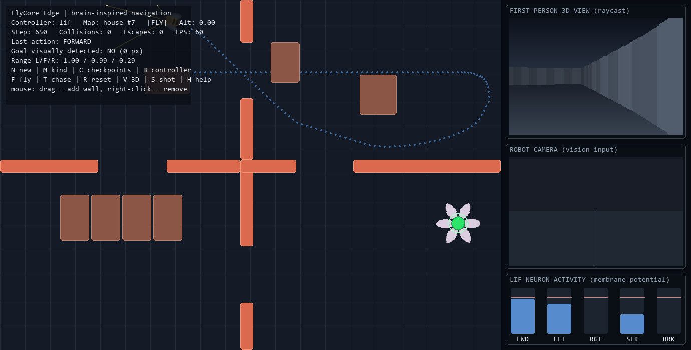

---

## ✨ Highlights

- **LIF spiking controller** — five leaky integrate-and-fire output neurons pick actions from range "danger" signals and visual goal bearing; turn-away wiring, visual-search drive, pre-spike action scoring. Safety rules (brake, committed avoidance with hysteresis) stay **outside** the network.
- **Fly-inspired reflex layer** — escape saccades on stall, drift detection for corner rocking, **novelty-based exploration** (saccade only when no *new* ground is covered), and a **re-acquire memory saccade** that turns back toward the last seen goal bearing.
- **Four procedural world kinds** — open / braided maze / rooms / **house** (doorways, low furniture, staircase), all seed-reproducible with a BFS-proven start→goal path, plus optional sequential **checkpoint puzzles**.
- **Honest physics** — the camera has a real **line-of-sight check** (no seeing goals through walls), body-radius-aware range rays, and blocked (never penetrating) collisions.
- **Flight & chase** — an altitude autopilot climbs the bee over low obstacles and stairs; chase mode makes the goal flee when the bee closes in.
- **Immersive 3D** — raycast first-person view (fullscreen with TAB), true camera-height projection (fly up and look *down* over walls), 360° mouse-look, minimap.
- **Perception stack** — from-scratch **SORT**: color detection → **Kalman filters** → **Hungarian algorithm** → persistent-ID **multi-object tracking** with occlusion bridging; swappable **YOLO11** detector trained on Kaggle GPU; **OpenCV** MP4 episode recording.
- **Edge deployment path** — C++ LIF kernel with 0/200,000-step action parity vs Python and an Arduino/ESP32 port with ultrasonic sensors.

## 📸 Gallery

| | |
|---|---|
| 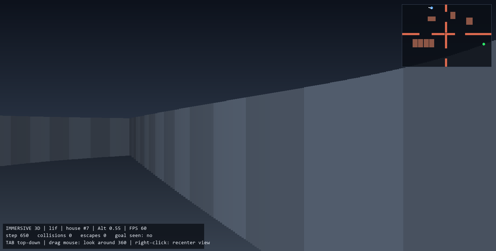 | 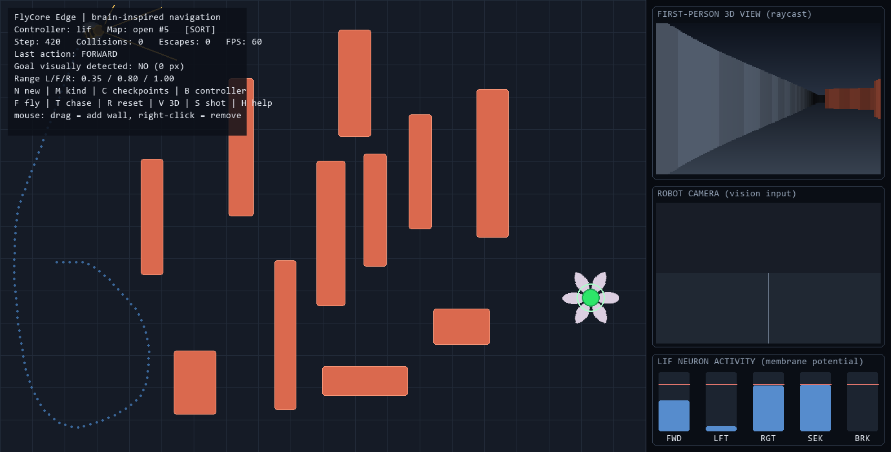 |
| **Immersive 3D (TAB)** — flying at altitude inside the house, looking down over walls; minimap top-right | **SORT tracking (O)** — Kalman + Hungarian boxes with persistent IDs on the camera panel |
| 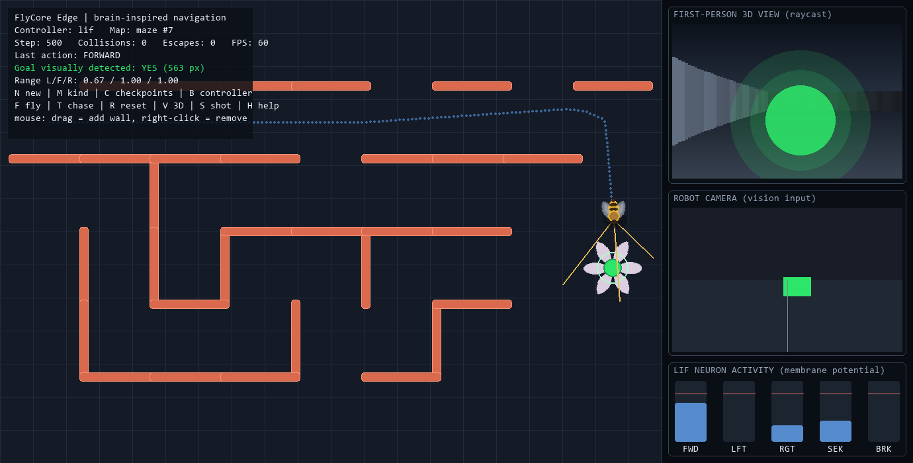 | 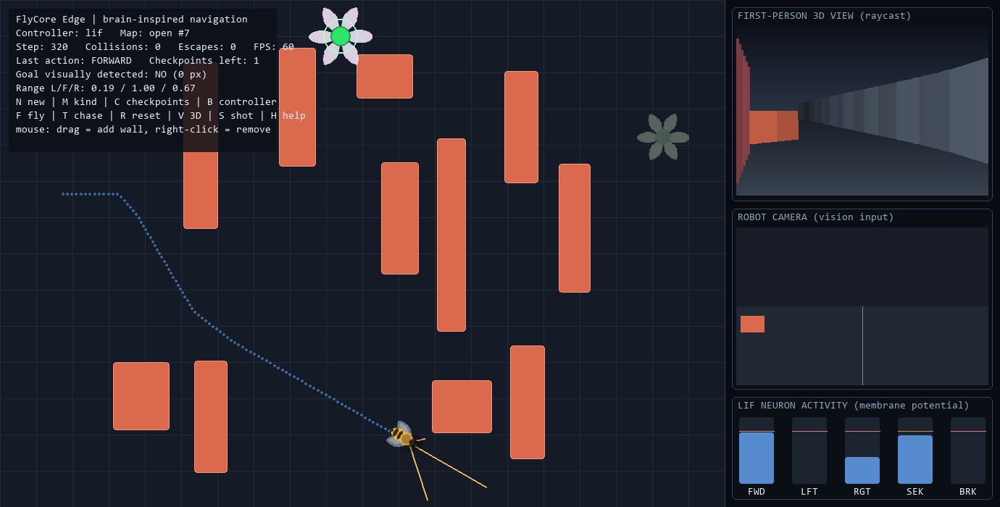 |
| **Maze world (M)** — braided recursive-backtracker corridors | **Checkpoint puzzle (C)** — amber buds must be visited before the goal activates |

<details>
<summary>Help overlay (press H in-game)</summary>

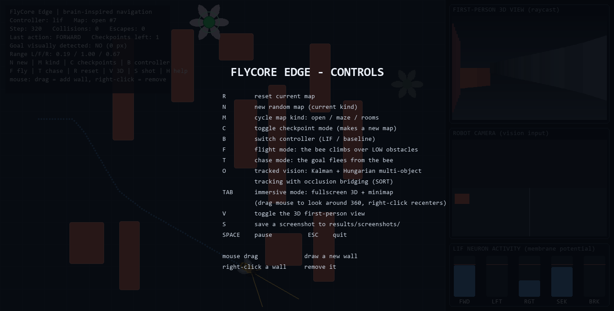
</details>

## 🚀 Quickstart

```bash
pip install -r requirements.txt
python main.py                                    # classic demo map
python main.py --kind house --immersive --fly     # straight into the 3D house
```

Python 3.10–3.14. The simulation core needs only `numpy`; `pygame-ce` is for the GUI, `ultralytics`/`opencv-python` only for the YOLO backend and video export.

## 🎮 Controls

| Key | Action |
|-----|--------|
| **R / N** | reset map / new random map (current kind) |
| **M** | cycle map kind: open → maze → rooms → house |
| **C** | toggle checkpoint puzzle mode |
| **F** | flight mode — altitude autopilot climbs over LOW obstacles & stairs |
| **T** | chase mode — the goal wanders and flees from the bee |
| **B** | switch controller (LIF ↔ rule-based baseline) |
| **O** | tracked vision: SORT (Kalman + Hungarian MOT) with occlusion bridging |
| **Y** | YOLO11 vision backend (uses `models/yolo11_goal.pt`) |
| **TAB** | immersive fullscreen 3D; drag mouse = 360° look, right-click recenters |
| **V / S / H** | toggle sidebar 3D view / screenshot / help |
| **Space / Esc** | pause / quit |
| mouse drag / right-click | draw a wall / remove a wall |

Launch flags: `--kind {open,maze,rooms,house}`, `--seed N`, `--immersive`, `--fly`, `--chase`.

## 🧠 How it works

```
camera frame ──► vision backend ──► (found, bearing) ─┐
                 color filter | SORT tracker | YOLO11  │
range rays  ──► L/F/R clearance (body-radius aware) ──┼──► LIF spiking network ──► action
                                                       │    (5 neurons, argmax of      │
pose        ──► reflex layer (stall / novelty /       ─┘     pre-spike potential)       ▼
                re-acquire saccades, may override)          FORWARD · LEFT · RIGHT · SEEK · BRAKE
```

1. The simulated camera renders a forward view; the active target is drawn green **only if a sight line exists** (walls occlude; low furniture does not).
2. Vision reports `(found, bearing error)`; three range rays report clearance, inflated by the robot's body radius.
3. Range "danger" and the bearing drive five LIF neurons — a LEFT turn is excited by danger on the *right* (turn-away wiring). The strongest **pre-spike** membrane potential picks the action.
4. A **visual-search** drive makes long ballistic runs increasingly attractive while the goal is unseen; explicit safety rules (brake, committed avoidance turns with release hysteresis) act outside the network.
5. The shared **reflex layer** breaks stalls, corner rocking, and unproductive loops with fly-style saccades, and remembers the last seen goal bearing for one re-acquire turn.

## 📊 Results

15 seeded maps per kind, identical reflex layer for both controllers, zero blocked collisions everywhere. The LIF controller wins **every structured world**; the rule-based baseline leads only on open fields.

| goal success | baseline | **LIF** |
|---|---|---|
| open | **86.7 %** | 80.0 % |
| rooms | 13.3 % | **40.0 %** |
| maze | 26.7 % | **46.7 %** |
| house | 0.0 % | **46.7 %** |

| 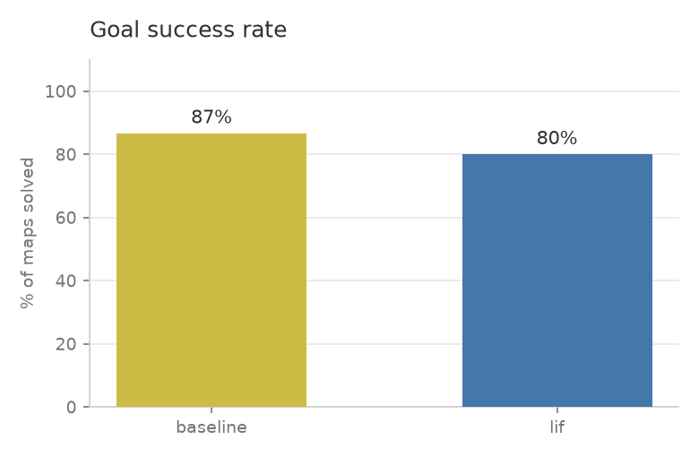 | 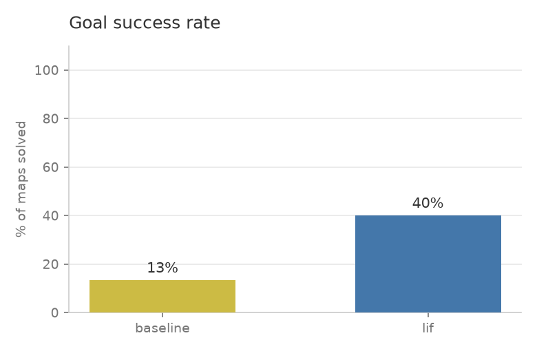 | 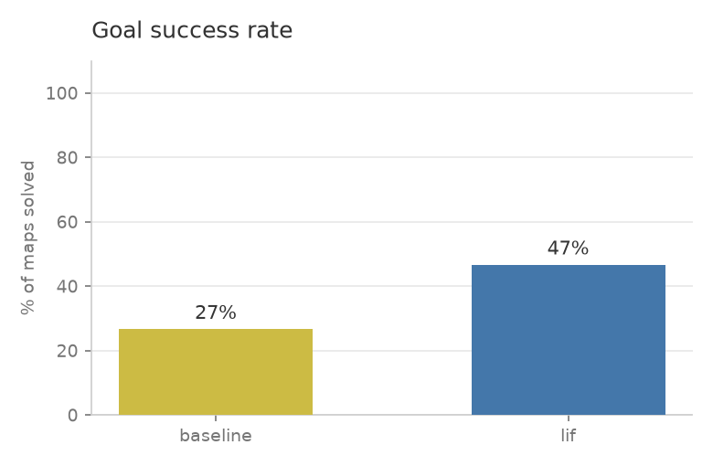 | 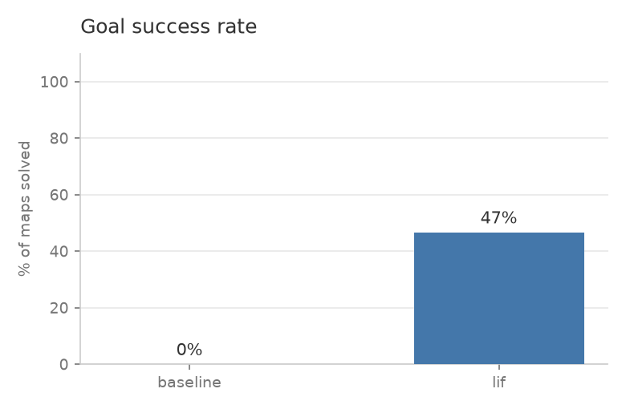 |
|---|---|---|---|
| open | rooms | maze | house |

Where both succeed, the LIF controller is also **faster** (open: 877 vs 1,176 steps) over shorter paths, at ~50 µs per decision — far under a real-time frame budget.

| 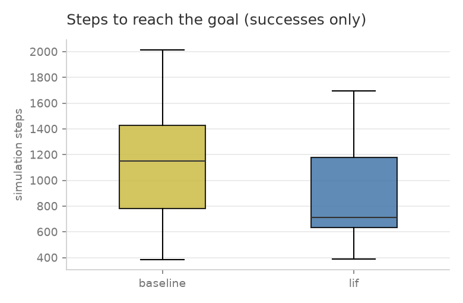 | 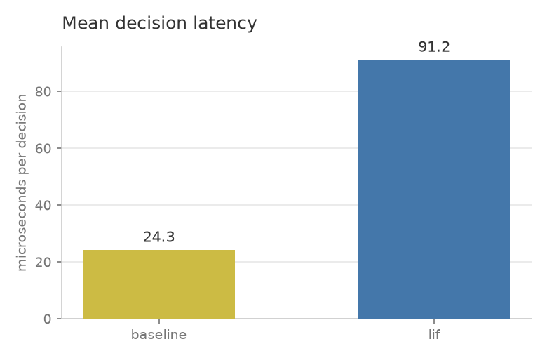 |
|---|---|
| steps to goal (open maps) | decision latency per controller |

Five defects were found and fixed along the way by batch experiments and GUI observation — including a camera that originally saw goals **through walls** and corner rocking below the stall detector's threshold. The full engineering story, Kaggle-scale sweeps (150 maps), hyperparameter grid search (+16 pp validated), and limitations are in [REPORT.md](REPORT.md).

## 👁 Perception stack

**SORT, from scratch** (`flycore/perception.py`): color-segmentation detections → per-track constant-velocity **Kalman filters** → **Hungarian algorithm** (Munkres, implemented from scratch) on an IoU cost matrix → track lifecycle with **persistent IDs**. While the goal is briefly occluded, its Kalman prediction keeps supplying a bearing, so the bee doesn't instantly forget a target that slid behind a wall. Every piece is unit-tested (assignment optimality, velocity estimation, ID persistence, occlusion bridging).

**YOLO11** (`flycore/vision_yolo.py`): a Kaggle GPU kernel synthesizes a labeled dataset **from the simulator itself** (1,650 frames, pixel-perfect auto-labels from the green mask) and fine-tunes `yolo11n` — no hand labeling. Trained weights drop in at `models/yolo11_goal.pt` and the **Y** key swaps the backend live.

| metric | value |
|---|---|
| mAP@50 (held-out val) | **0.995** |
| mAP@50-95 | 0.965 |
| CPU inference | 24.6 ms/frame (color filter: 0.5 ms) |

| 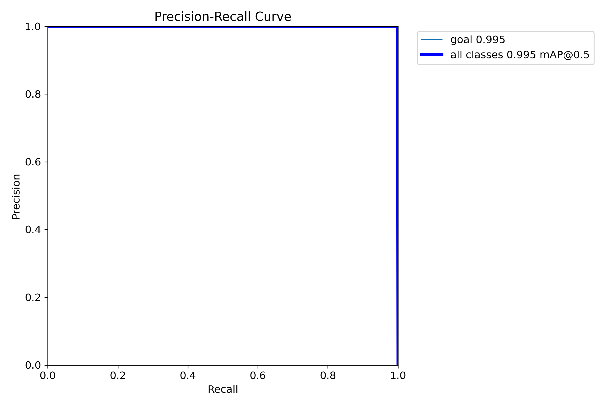 | 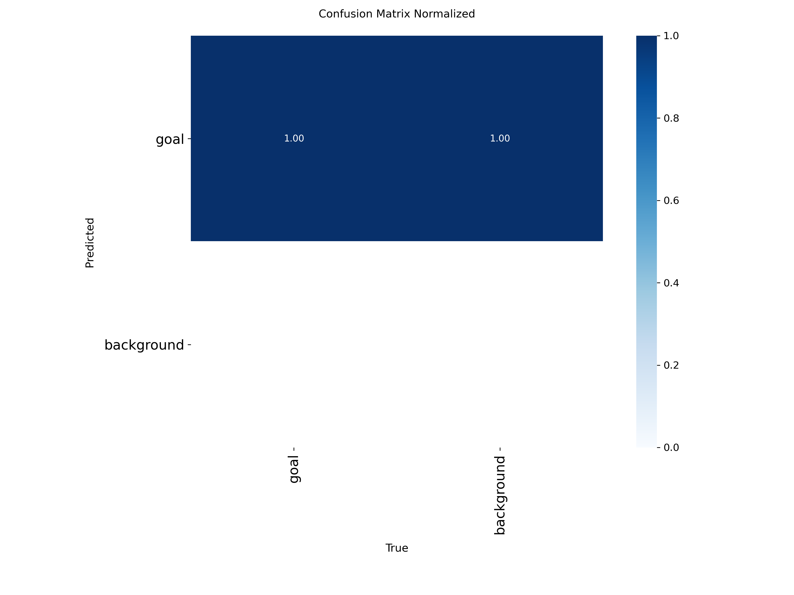 | 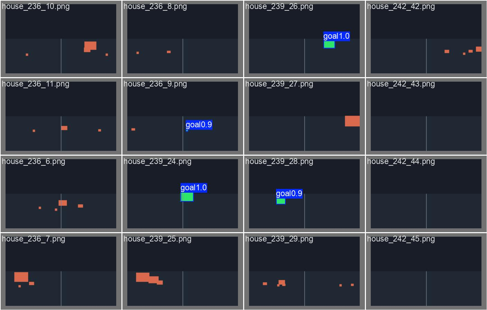 |
|---|---|---|
| precision–recall | confusion matrix | validation predictions |

**OpenCV video export**: render any episode straight to MP4 — `python -m experiments.record_video --kind house --fly --tracker` (add `--immersive` or `--chase`).

## 🔬 Experiments & reproducibility

```bash
python -m unittest discover -s tests -v                    # 35 tests
python -m experiments.run_experiments --episodes 15 --kind house
python -m experiments.analyze --csv results/results.csv    # figures + summary
python -m experiments.make_yolo_dataset                    # synthesize YOLO data locally
```

Every map is seed-deterministic: the same seed reproduces the same world, episode, and metrics on any machine. Each episode logs success, steps, blocked collisions, path length, mean/p95 decision latency, vision latency, peak memory, and reflex escapes.

### Kaggle cloud pipelines

```bash
python kaggle_run/run_on_kaggle.py --username <you>          # CPU: sweeps + grid search + C++ parity
python kaggle_run/run_on_kaggle.py --username <you> --yolo   # GPU: YOLO11 training on synthesized data
```

Both bundle the project as a **self-contained kernel** (source embedded as a base64 zip), push it via the Kaggle API, poll, and fetch outputs — the YOLO run installs the trained weights automatically. Token setup: kaggle.com → Settings → API → save to `~/.kaggle/access_token`. **Never commit tokens.**

## ⚡ C++ kernel

`cpp/lif_controller.cpp` mirrors the Python controller line-for-line and exposes a C ABI consumed via ctypes. Methodology is **parity-first**: `experiments/bench_cpp.py` must find **zero** action mismatches over 200,000 identical steps before any speed numbers are reported (measured: 0 mismatches, 1.65× speedup including FFI overhead).

```bash
g++ -O2 -shared -fPIC -o cpp/libflycore_lif.so cpp/lif_controller.cpp
python -m experiments.bench_cpp --steps 200000
```

## 🔌 Hardware

The controller needs only three range readings and a goal bearing, so it ports to real robots: [arduino/](arduino/) has a complete **Arduino/ESP32 sketch** (~$20 of parts — 3× HC-SR04 ultrasonic, 2× LDR "vision", L298N motors) running the identical LIF logic, plus Raspberry Pi instructions and the mapping to drone yaw/velocity commands.

## 📁 Project layout

```text
flycore-edge/
├── main.py                     # GUI app (pygame) — all modes & launch flags
├── flycore/                    # simulation core — numpy only, no pygame
│   ├── config.py               # tunable settings
│   ├── geometry.py             # minimal Rect (pygame-free collision math)
│   ├── maps.py                 # open/maze/rooms/house generators + checkpoints + BFS guarantee
│   ├── environment.py          # world, motion, flight autopilot, chase, LOS camera
│   ├── vision.py               # color-based goal detection
│   ├── vision_yolo.py          # YOLO11 backend (Kaggle-trained weights)
│   ├── perception.py           # SORT: Kalman + Hungarian + MOT (from scratch)
│   ├── sensors.py              # body-radius-aware range rays
│   ├── controller.py           # LIF spiking controller (parameterizable)
│   ├── baseline.py             # rule-based baseline controller
│   ├── reflex.py               # saccades: stall / drift / novelty / re-acquire
│   ├── runner.py               # headless episode runner + metrics
│   ├── cpp_bridge.py           # ctypes bridge to the C++ kernel
│   ├── sprites.py              # animated bee + flowers (asset-free)
│   ├── view3d.py               # raycast pseudo-3D first-person view
│   └── render.py               # pygame drawing: world, sidebar, immersive mode
├── experiments/
│   ├── run_experiments.py      # batch CLI → results CSV + summary JSON
│   ├── analyze.py              # plots + markdown summary
│   ├── bench_cpp.py            # Python↔C++ parity + speed benchmark
│   ├── make_yolo_dataset.py    # simulator → YOLO dataset synthesizer
│   └── record_video.py         # OpenCV MP4 episode recorder
├── kaggle_run/
│   ├── build_kernel.py         # self-contained CPU experiment kernel
│   ├── build_yolo_kernel.py    # GPU YOLO11 training kernel
│   └── run_on_kaggle.py        # push → poll → fetch via Kaggle API
├── cpp/                        # C++ LIF kernel + C ABI (CMake / g++)
├── arduino/                    # Arduino/ESP32 port + wiring guide
├── models/                     # trained YOLO11 weights
├── docs/images/                # README gallery
└── tests/test_core.py          # 35 unit tests
```

## ✅ Tests

```bash
python -m unittest discover -s tests
```

35 tests cover vision (incl. wall occlusion), geometry, all four map generators' solvability, checkpoint sequencing, flight over low obstacles, chase legality, corner escape, the Hungarian/Kalman/SORT stack, environment physics, the headless runner, and Python↔C++ parity.
